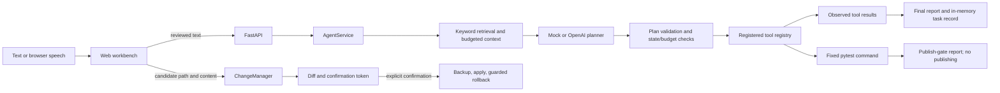

# SafeDesk Agent

SafeDesk is a personal practice project: a local, bounded coding-task agent that plans, retrieves project context, runs registered tools, and requires explicit confirmation before applying a proposed file change.

It is not a production service, has no real customer or business-impact claims, and has not received a production security review.

## Scope

- Offline mock planner and configurable OpenAI-compatible Responses / Chat Completions adapters.
- Chinese model-settings form with encrypted local configuration restored on restart, explicit upstream model discovery, and a native model selector.
- Local web workbench for text tasks, task history, plans, tool traces, and reports.
- Browser-provided speech recognition when the browser supports it; recognized text is reviewed before submission.
- Browser speech synthesis for voice and text-plus-voice output. Text reports remain visible if speech is unavailable or fails.
- Keyword retrieval with source metadata and a context budget. A deterministic mock-embedding interface is tested separately; no real embedding provider is configured.
- Registered tools: `read_file`, `list_tasks`, `search_code`, and a fixed `pytest` command.
- Candidate changes are diffed first, scoped to `workspace/`, and require a separate confirmation request. Backups and guarded rollback are available.
- A bounded repair-session API passes fixed-test failure output to an optional planner repair adapter, returns a candidate diff, waits for its matching one-time confirmation token, reapplies the fixed tests, and stops after two proposals.
- A local publish-gate endpoint reports readiness only; it never publishes or deploys.

Not supported: unattended listening, wake words, arbitrary shell/Python execution, automatic deployment or push, production systems, distributed agents, or unrestricted automatic code repair. Task and memory data are currently in process memory; local evaluation output and change backups live under ignored `data/`.

## Requirements

Tested locally on Windows with Python 3.14.4. The pinned direct dependencies are in `requirements.txt`; the runtime and transitive dependency versions used during this verification were:

| Component | Version |
| --- | --- |
| Python | 3.14.4 |
| FastAPI | 0.141.1 |
| Uvicorn | 0.53.0 |
| Pydantic | 2.13.5 |
| OpenAI Python SDK | 3.37.0 |
| pytest | 9.1.1 |
| httpx | 0.28.1 |

PowerShell, from the project directory:

```powershell
py -3.14 -m venv .venv
.\.venv\Scripts\python.exe -m pip install -r requirements.txt
```

`.env.example` contains only a deliberately invalid placeholder and documents variable names; the application reads process environment variables and does not automatically load `.env`. Set variables in the current PowerShell session:

```powershell
$env:SAFE_DESK_MODEL = "mock"
```

To configure the optional real model adapter, set `SAFE_DESK_MODEL` to `openai`, then set `OPENAI_API_KEY`, and optionally `OPENAI_BASE_URL` and `OPENAI_MODEL` in the shell. Never put a working key in source control, test output, or this README. The missing-key startup path is covered by tests; a real external model call has not been re-run as part of this project delivery.

Start the local API and workbench:

```powershell
.\.venv\Scripts\python.exe -m uvicorn apps.api.main:app --host 127.0.0.1 --port 8000
```

Open `http://127.0.0.1:8000/`. The mock planner supports a small set of predictable read/search/test requests and asks for clarification otherwise. Task records are held in memory and disappear when the process exits.

### 在页面配置模型并保存

1. 展开页面顶部的“模型设置”，填写服务商的 Base URL 和 API Key，点击“获取模型”。不必预先知道或填写模型 ID。
2. 在出现的“上游模型”下拉框选择模型；也可直接手动填写“模型名称”。按服务商支持情况选择 `Chat Completions` 或 `Responses`。URL 填基础地址，例如以 `/v1` 结尾，不填完整的 `/chat/completions` 或 `/responses` 路径。
3. 点击“保存并启用”。配置写入项目的 `data/model-settings.json`，下次启动自动读取，无需重新填写。保存不会向模型发送请求，不代表连接已经验证。
4. “测试连接”会先确认，再发送一条最多 64 个输出 token 的短请求，可能收费；不会发送项目上下文或执行工具。它只验证接口响应，不验证任务规划质量。部分第三方服务不完全兼容这两种协议或其参数，仍需用实际服务验证。
5. 已保存密钥不回传页面。密钥框留空表示继续使用原密钥；修改 Base URL 时必须重新填写密钥。“切回模拟模式”保留加密配置，“删除已存配置”清除保存的配置并切回模拟模式。

“获取模型”使用密钥向填写的上游 Base URL 下的 `/models` 发送一次认证查询；不会发送项目内容、进行生成推理、保存新配置或切换当前模型。页面不会自动查询，刷新后需要再次点击获取，已保存的同地址密钥可直接复用。列表去重排序，最多显示 2000 个有效模型 ID；不自动继续获取供应商特有的分页。不支持该接口、鉴权失败、空列表或网络异常时可继续手动填写。列表显示的是上游返回的目录，不保证每个模型都有推理权限，也不能据此判断支持哪种协议；真实可调用性仍需显式测试。修改地址或密钥会清空旧候选列表。

密钥使用 Windows 当前用户的 DPAPI 加密，不以明文写入配置文件，不放入浏览器存储。配置文件、临时文件及日志均在 Git 忽略范围内。Base URL、模型名称和协议不是加密字段；不要在 URL 中放密钥。HTTPS 是默认要求，仅本机模型服务允许 HTTP；客户端不跟随重定向，不自动使用环境代理。

此持久化方式仅支持 Windows，通常只能由同一台计算机上的同一个 Windows 用户解密。它不能防御同一用户权限下的恶意程序，也不是生产级密钥管理。配置损坏或无法解密时保留原文件、提示错误并退回模拟模式。保存失败时保留原配置。设置接口仅允许本机访问和同源页面写入，应用仍必须绑定 `127.0.0.1`，不应暴露到局域网或公网。

已保存的模式优先于环境变量，包括明确保存的模拟模式；没有配置文件时才沿用环境变量配置。删除配置会保存一个不含密钥的模拟模式记录，而不是恢复环境变量。若确需重新使用环境变量，先停止服务，再自行检查并移走该配置文件。

启用真实模型后，运行任务会把任务文本、选中的检索片段及工具结果发送到你填写的服务商，修复建议会发送测试失败摘要。不要把敏感代码或个人资料放进练习目录。当前仅验证了本机加密存储、真实 SDK 配合模拟 HTTP 响应的协议适配和浏览器交互，尚未用真实密钥验证外部模型。

## Architecture and data flow



`AgentService` owns task state, idempotency, budgets, context selection, and planner/tool coordination. `ToolRegistry` validates tool arguments and owns fixed tool behavior. `ContextIndex` chunks supported project Markdown/Python sources and reports `keyword_fallback` unless a separately injected embedding implementation is used. `MemoryStore` is an in-memory, clearable preference/session store, separate from indexed knowledge. The current UI does not expose persistent memory management because memory itself is not persisted.

Task states include `received`, `clarifying`, `planned`, `running`, `verifying`, `succeeded`, `failed`, and `blocked`. Unknown tools, invalid plans, exceptions, failed fixed tests, and budget exhaustion do not become successful tasks.

## API and tool boundary

| Route/tool | Behavior |
| --- | --- |
| `GET /health` | Compatibility health response |
| `GET /` | Serve the workbench |
| `GET /settings/model` | Return redacted model status; never return the key |
| `PUT /settings/model` | Encrypt, persist and enable model configuration; no network call |
| `POST /settings/model/test` | Explicit bounded connection probe; does not save or run tools |
| `POST /settings/model/models` | Explicit authenticated upstream model catalog query; URL/key only, no model required; no settings mutation |
| `POST /settings/model/mock` | Persist mock mode while retaining encrypted settings |
| `DELETE /settings/model` | Clear saved credentials/configuration and persist mock mode |
| `POST /tasks` | Execute one text task through the agent service |
| `GET /tasks`, `GET /tasks/{task_id}` | Read in-memory task records |
| `POST /changes/proposals` | Create a diff-only candidate for a path under `workspace/` |
| `POST /changes/proposals/{token}/apply` | Require explicit `confirmed: true`; create a backup before writing |
| `POST /changes/{change_id}/rollback` | Restore only if the applied file is unchanged since apply |
| `POST /repairs` | Run fixed tests; on failure request and return a bounded candidate diff |
| `POST /repairs/{repair_id}/confirm` | Require the current diff token, apply after confirmation, rerun tests, and continue or stop |
| `POST /checks/publish-gate` | Evaluate a supplied local check summary; does not publish |
| `read_file` | Read supported text files inside the example workspace |
| `list_tasks` | Return in-memory task summaries |
| `search_code` | Search supported project source files, excluding runtime data and caches |
| `run_tests` | Run only the fixed project pytest command with bounded time/output |

The model cannot supply a shell command. Change proposals revalidate containment and symlinks before reading or applying; invalid proposal paths return an error. The confirmation token binds the confirmation request to the currently returned proposal and is single-use, but cannot prove that a human visually inspected the diff and is not an authentication mechanism. The local server is intended for loopback use and has no user authentication or multi-user isolation.

## Speech and retrieval limits

Speech recognition is browser-native (`SpeechRecognition` / `webkitSpeechRecognition`) and may be missing, permission-blocked, or vendor-dependent. The browser service may send audio to its provider; this project does not configure or verify that provider. Users can stop or cancel recording, review/edit recognized text, and only then submit it to the same text-task endpoint. There is no independent server-side STT adapter or real STT integration test.

Speech output uses browser `speechSynthesis`. Support and voice selection vary by browser/OS. A speech playback error does not remove the on-screen report. No real audio service has been validated.

Default retrieval is lexical keyword fallback, not semantic vector search. Source paths and starting lines are retained for included chunks; context is truncated deterministically to the configured budget. The mock embedding implementation proves only the injectable interface and deterministic unit behavior, not embedding quality. A query miss is reported without inventing a source.

## Run tests and evaluation

```powershell
.\.venv\Scripts\python.exe -m pytest tests -v -p no:cacheprovider
.\.venv\Scripts\python.exe -m evaluation.run
```

The fixed evaluation suite uses the mock planner and a fake nonzero test-tool response for the failure case. It records input, expectation, actual output, pass/fail, failure layer, elapsed time, model calls, and cost. Mock evaluation records zero model calls and cost `unknown`; it is not a real-model quality or latency benchmark. The command writes `data/evaluation.json`, which is ignored by Git.

Most recent local evaluation run in this workspace (Windows, Python 3.14.4, mock mode):

| Case | Expected behavior | Result |
| --- | --- | --- |
| Read-only request | Read the example file and report its contents | Passed; report contained `这是练习文件` |
| Ambiguous request | Ask for clarification | Passed; status `clarifying` |
| RAG hit | Show `rules.md` as a keyword-fallback source | Passed; source `rules.md` returned |
| RAG miss | Return no fabricated source | Passed; no context source returned |
| Unknown tool | Reject and fail the task | Passed; `unknown_tool`, status `failed` |
| Test failure | Report the nonzero result as failed | Passed; fake tool returned exit code 1 and task status was `failed` |

Aggregate output was `6 passed, 0 failed`. Individual elapsed times, full actual outputs, and explicit `cost: "unknown"` entries are in the ignored `data/evaluation.json`. This is deterministic mock-path behavior, not an external-model evaluation.

## Demo

1. Start the API using the command above and open the local workbench.
2. Submit `Read example.txt`; inspect the status, plan, trace, and final report.
3. Submit an unclear request; inspect the clarification result.
4. To exercise a change in an isolated disposable copy of the project, request a proposal under `workspace/`, review its diff, then explicitly confirm it. Run the fixed test tool and inspect the real exit code/output. Do not use the sample workspace for personal data.
5. Try a proposal path such as `../private.txt`; the proposal must be rejected before any external file content is read.
6. Use browser speech only after checking browser support and permissions. Verify the recognized text and edit it before submission; this project has not validated an actual microphone/STT provider.

## Local data and cleanup

- Task records and memory are in process memory only.
- Backups are written under `data/backups/`.
- Evaluation output is written to `data/evaluation.json`.
- Model configuration is written to `data/model-settings.json`; only the API key is DPAPI-encrypted. Use the page's confirmed clear action to remove it without removing change backups.
- `.env`, data, logs, databases, recordings, Python caches, and virtual environments are ignored by Git.
- Stop the local server before removing `data/` if you want to clear backups and evaluation records. Review the directory before deletion; it may contain recovery data.

## Verification status and known limitations

- Automated tests exercise mock planner flows, fixed tool validation, retrieval modes, confirmation, rollback guards, and API behavior.
- On November 6, 2026, the model-settings and discovery suites returned `46 passed` (26 existing settings tests plus 20 discovery tests); the full suite returned `115 passed, 2 failed`. Both failures existed before these features: `/health` returns the user's `busy` value while `test_health_route_remains_compatible` expects `ok`, and symlink rejection raises a different error message from `test_apply_rejects_workspace_escape_and_symlink`'s expectation. Neither was changed to make this feature appear green. The local project is not currently all-green or ready to publish.
- The OpenAI-compatible adapters are tested using the installed real SDK and simulated HTTP responses for both protocols, including a reasoning/output-limit response and sanitized failures. External network/model behavior and cost are not verified here.
- Embeddings are tested with a deterministic mock only; no external embedding provider is configured.
- Edge/Playwright checks verified Chinese UI, actual local mock task submission, encrypted configuration save/restart/reload/clear, and 1280/375/320px layouts. The settings checks passed 11 grouped checks; the existing Chinese UI smoke passed 10. Simulated speech/error checks do not verify a real microphone, STT, or TTS service.
- Model discovery passed 12 grouped browser checks against a local fake upstream, including real SDK/HTTP authentication with dummy credentials, selection/save/reload, saved-key reuse, empty/error states, stale-list invalidation and desktop/mobile rendering. No real provider catalog, model availability or inference permission was verified.
- Repair-session tests use controlled planner suggestions and fixed-test responses. The optional real-model repair adapter has not been verified against an external model or an actual repairable project test failure.
- A previous clean temporary Python 3.14.4 environment verification is historical, not evidence that the latest tree is all-green. This feature was tested in the existing virtual environment; a new clean-environment installation was not repeated. The six mock evaluations were rerun with `6 passed, 0 failed`. Transitive dependencies are not locked.
- This practice project is not production-ready and has no production deployment, customer usage, or measured business impact.

## Honest project summary

**Problem:** A coding assistant needs bounded access to project files and test execution instead of unrestricted command execution.

**Approach:** Build a local FastAPI and HTML workbench, separate planning/context/tools, validate registered tool calls, require human confirmation for file writes, and gate reports on fixed test outcomes.

**Verification:** Use automated mock/API/security tests and a fixed six-case offline evaluation; keep real model, embeddings, and browser speech claims separate from mocks.

**Limit:** The implementation is a personal practice project. Authentication, persistent task storage, a real STT adapter, production security review, and external-model-driven repair behavior remain outside verified scope.
